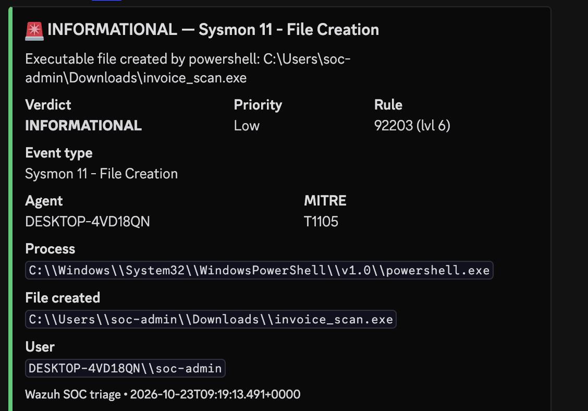
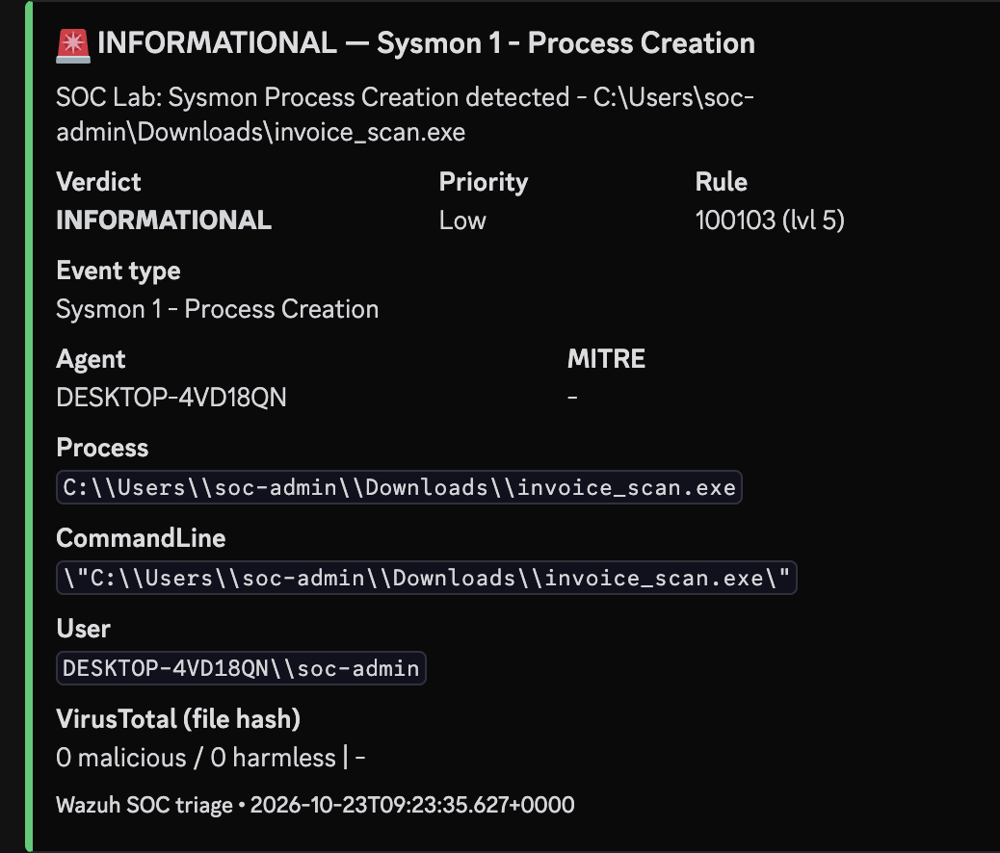
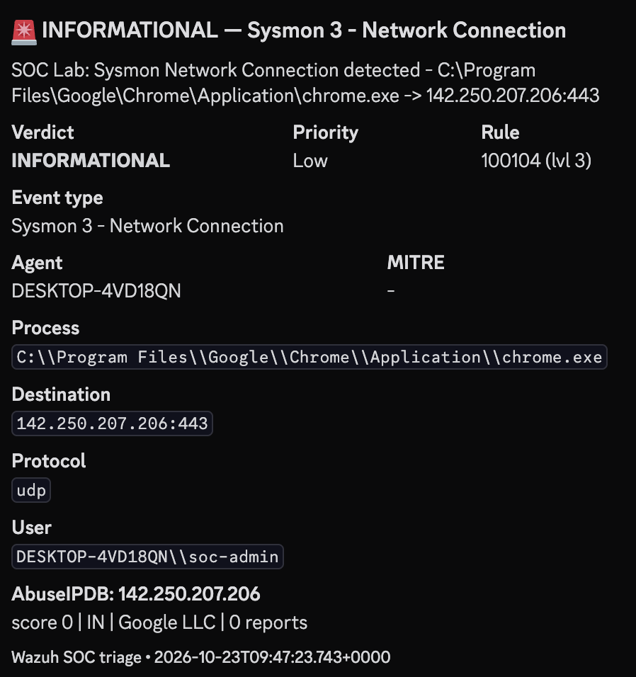
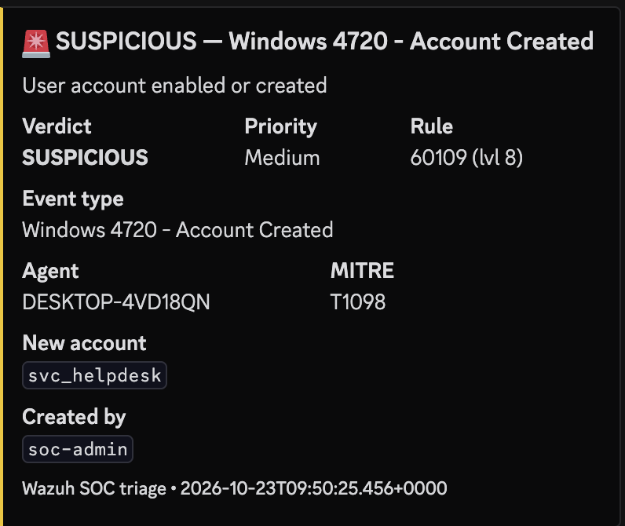
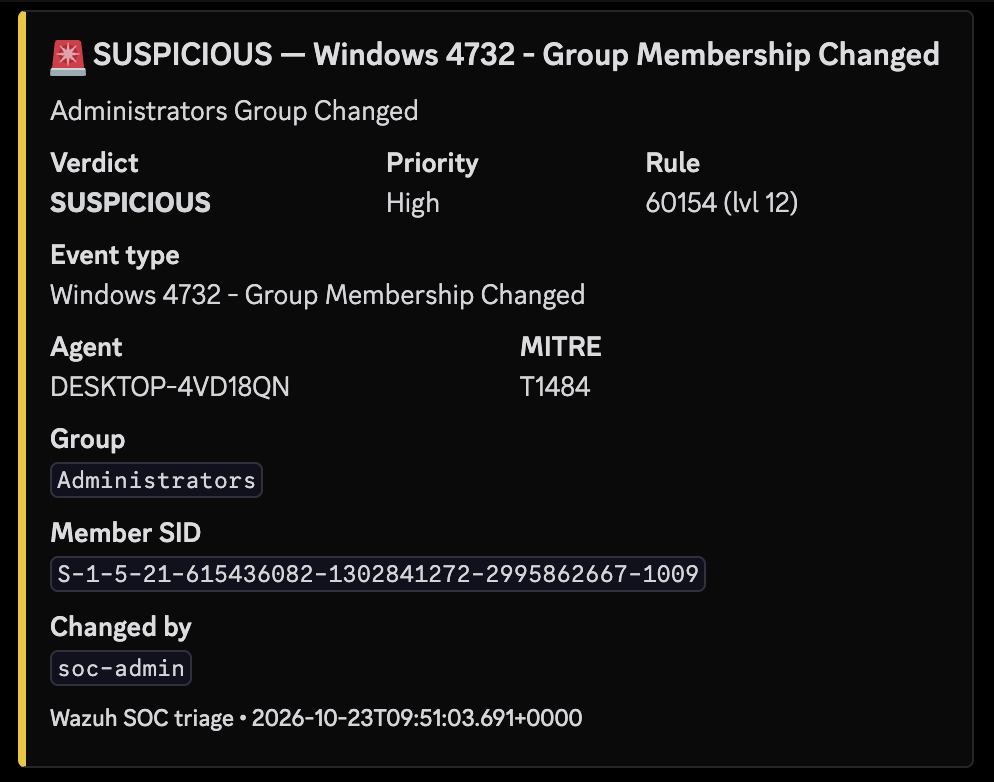
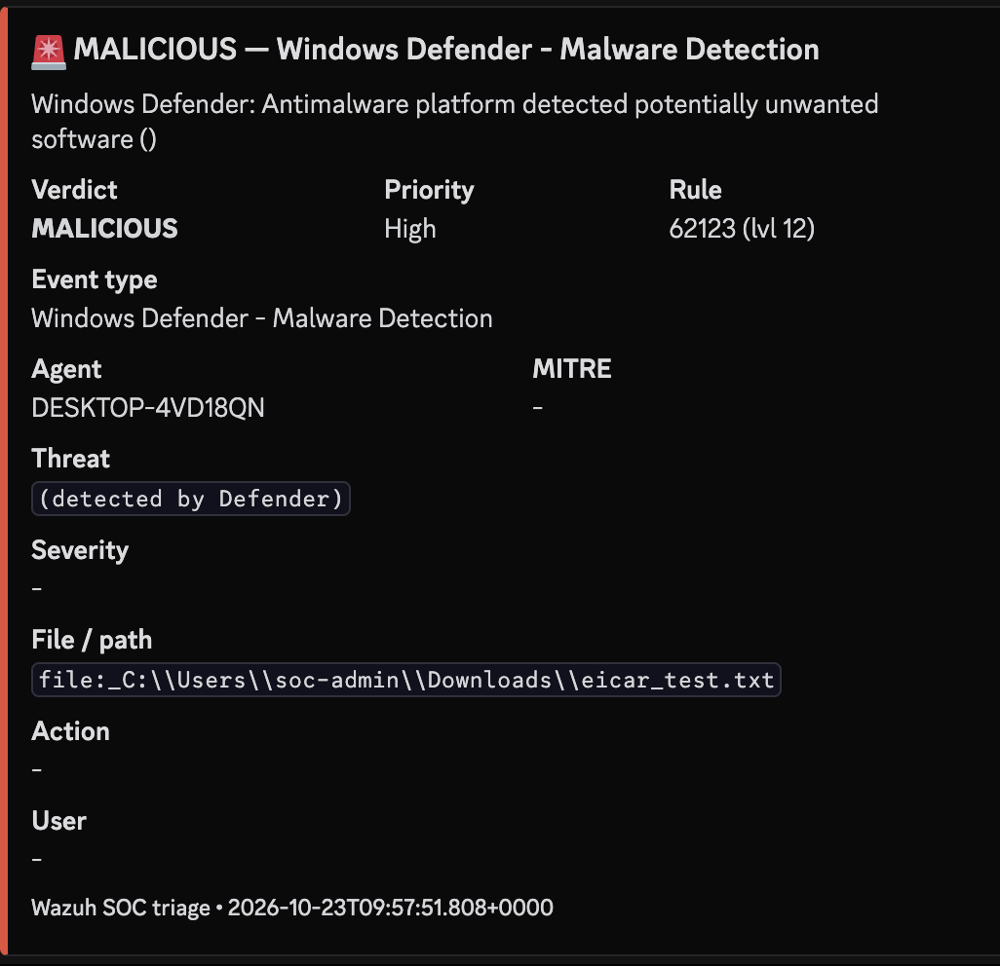

# ⚙️ Automated Alert Triage & Enrichment Pipeline (SOAR-lite on Wazuh)

A lightweight, self-built **SOAR-style pipeline** on top of Wazuh. When a qualifying alert fires, it automatically extracts the key indicators, enriches them against threat-intelligence services, assigns a verdict and priority, and posts an analyst-ready card to Discord — the context-gathering work that mature SOC teams automate first.


---

## 📌 Objectives

- Automatically enrich Wazuh alerts with external threat intel (IP reputation, file-hash reputation, geolocation)
- Assign each alert a clear verdict (**Informational / Suspicious / Malicious**) and priority
- Deliver enriched alerts to an analyst channel (Discord) in real time
- Trigger automatically from Wazuh for high-signal alerts; support on-demand enrichment for high-volume telemetry
- Validate end-to-end against a controlled attack simulation

---

## 🔄 How the Pipeline Works

```
Wazuh alert ──▶ (1) Parse ──▶ (2) Enrich ──▶ (3) Score ──▶ (4) Notify (Discord)
```

1. **Parse** — read the alert JSON, extract useful fields (event type, rule, MITRE, process, user, destination IP, file hash)
2. **Enrich** — destination IPs via **AbuseIPDB** (reputation + country + ISP), file hashes via **VirusTotal** (engine detections); private/internal IPs are recognised and skipped
3. **Score** — combine rule severity + enrichment into a verdict and priority
4. **Notify** — format a colour-coded card (green / orange / red) and POST it to a Discord webhook

> API keys and the webhook URL are kept in a **separate credentials file, out of the code** — no hard-coded secrets.

---

## 🧮 Verdict Logic

| Condition | Verdict | Priority |
|---|---|---|
| VirusTotal flags the hash, **or** AbuseIPDB score ≥ 50, **or** a Defender detection | 🔴 **Malicious** | High |
| AbuseIPDB score ≥ 10, **or** Wazuh rule level ≥ 12 | 🟠 **Suspicious** | High |
| Wazuh rule level ≥ 7 | 🟠 **Suspicious** | Medium |
| Otherwise | 🟢 **Informational** | Low |

---

## 🔌 Enrichment Sources

| Source | Returns | Validated against |
|---|---|---|
| **AbuseIPDB** | Abuse-confidence score, country, ISP, report count | A known public IP (Google DNS) |
| **VirusTotal** | Engine detections + threat label for a file hash | EICAR test-file hash (60+ detections) |

---

## 🧪 End-to-End Validation

The pipeline was proven against a controlled six-stage simulation covering both Sysmon and Windows Security telemetry plus a live AV detection. Each card below is the live Discord output.

| # | Stage / event | Rule (level) | Verdict | Enrichment |
|---|---|---|---|---|
| 1 | Sysmon 11 — file dropped | 92203 (6) | 🟢 Informational | — |
| 2 | Sysmon 1 — process run | 100103 (5) | 🟢 Informational | VirusTotal (clean) |
| 3 | Sysmon 3 — network connection | 100104 (3) | 🟢 Informational | AbuseIPDB (real IP) |
| 4 | Windows 4720 — account created | 60109 (8) | 🟠 Suspicious | — |
| 5 | Windows 4732 — group changed | 60154 (12) | 🟠 Suspicious | — |
| 6 | Windows Defender — malware | 62123 (12) | 🔴 Malicious | Defender verdict |








---

## 🧠 Design Decisions

- **Auto vs on-demand:** high-signal, low-volume events (file drop, account, group change, AV detection) are auto-triaged; high-volume events (process, network) are enriched on-demand to avoid flooding the channel and burning API quota — the same reason real SOCs don't auto-enrich everything.
- **Server-side integration:** the pipeline runs via Wazuh's native integration on the **manager** side, where the alerts already are. Unlike the agent-side Active Response in the endpoint project, automatic dispatch worked first time.
- **Threshold tuning:** the file-drop fired rule 92203 at level 6, below the initial level-8 trigger; the threshold was lowered to 6 to include file-creation — normal detection-engineering work.

---

## 🚀 Possible Extensions

- Enrich domains/URLs from DNS (Sysmon event 22)
- Add more threat-intel sources (OTX, GreyNoise, internal block-lists)
- Auto-ticketing (write a case file / tracker entry alongside the Discord card)
- Response actions (auto-disable a flagged account, block an IP on a confirmed-malicious verdict)
- De-duplication, alert grouping, API rate-limit handling

---

## ⚠️ Honesty Note

The Python implementation was written **with AI assistance**, used as a tool to implement my design quickly. The engineering that makes this project mine — the system design, the choice of event types and intel sources, the verdict/scoring logic, the Wazuh integration, the troubleshooting, and all testing and validation — was done by me.

---

## 📚 Skills Demonstrated

`SOAR concepts` · `Threat-intel enrichment` · `AbuseIPDB` · `VirusTotal` · `Alert triage & scoring` · `Wazuh integrations` · `Detection-engineering` · `Secrets hygiene` · `End-to-end validation`

---

## 📄 Full Documents

- 📘 [Project Documentation (PDF)](docs/project-documentation.pdf)
- 📝 [Validation Report (PDF)](docs/validation-report.pdf)
